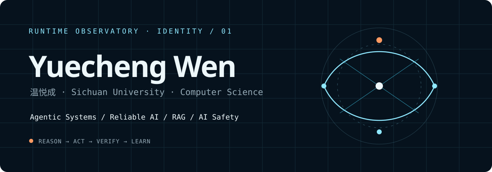

  

## Hello, I'm Yuecheng Wen

**温悦成 · Computer Science undergraduate at Sichuan University**

I build and study AI systems that need to reason, collaborate, retrieve evidence, and remain observable under real-world constraints. My current interests center on **agentic systems**, **reliable AI**, **retrieval-augmented generation**, **multi-agent collaboration**, and **AI safety**.

- Exploring reliable runtimes, evaluation harnesses, memory, context engineering, Skills, and MCP
- Turning research questions into deployable and testable systems
- Open to postgraduate study, research opportunities, and technical collaboration

## Selected systems

| System | What it demonstrates | Links |
| --- | --- | --- |
| **Yuecheng-Harness** | A local extensible runtime for coding agents, with tool governance, context folding, memory, Skills, MCP, sub-agents, session recovery, and replay evaluation. | [Repository](https://github.com/WenYuecheng/Yuecheng-harness) · [Case study](https://wenyuecheng.cn/projects/yuecheng-harness/) |
| **MindBridge** | A safety-governed, event-driven multi-agent system for campus mental-health support, with auditable risk handling, hybrid retrieval, and human handoff. | [Live system](https://mindbridge.wenyuecheng.cn) · [Case study](https://wenyuecheng.cn/projects/mindbridge/) |
| **EduRAG Agent** | A learning and interview-coaching agent built around hybrid retrieval, reranking, streaming answers, evaluation, and structured study workflows. | [Repository](https://github.com/WenYuecheng/edurag-agent) · [Case study](https://wenyuecheng.cn/projects/edurag-agent/) |
| **Chat2Excel** | A natural-language-to-data system combining Spring AI, NL2SQL, microservices, distributed coordination, and SSE delivery. | [Repository](https://github.com/WenYuecheng/chat2Excel) · [Case study](https://wenyuecheng.cn/projects/chat2excel/) |

## Research and engineering interests

`Agent Runtime` · `Multi-Agent Systems` · `Reliable AI` · `RAG` · `AI Safety` · `Multimodal Reasoning` · `Evaluation Harnesses`

## Working toolkit

`Python` · `C++` · `SQL` · `Java` · `FastAPI` · `Spring Boot` · `Redis` · `Chroma` · `Docker` · `MCP`

## Education

**Sichuan University** — B.Eng. candidate in Computer Science and Technology, expected 2027
GPA **3.85/4.00** · Weighted average **91.01/100** · Cohort rank **26/320** · IELTS **7.0**

## Connect

Primary portfolio: <a href="https://wenyuecheng.cn">wenyuecheng.cn</a> · GitHub Pages mirror: <a href="https://wenyuecheng.github.io">wenyuecheng.github.io</a>
